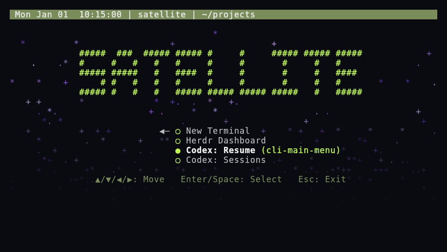

# SATELLITE CLI

A Bash launcher for Codex sessions and Codex Switcher's session manager.
Its animated star field adapts to your terminal size.



## Get started

Place this directory anywhere persistent and add these lines to `~/.bashrc`
(replace the path with your checkout):

```bash
export CLI_MAIN_MENU_DIR="/path/to/cli-main-menu"
source -- "$CLI_MAIN_MENU_DIR/init.bash"
```

Then reload your shell and open the menu:

```bash
source ~/.bashrc
startup
```

Sourcing the file only defines commands; it does not open the menu. Bash 4+,
`date`, `stty`, and `clear` are required. Codex integration needs `tmux`, `jq`,
and a current `codex-switcher` with enrolled accounts. Keep the same
`CODEX_SWITCHER_HOME` in your shell and switcher service.

### Unraid

Keep the checkout at `/mnt/user/live/projects/cli-main-menu` and the switcher
binary at `/mnt/user/live/packages/codex-switcher/bin/codex-switcher`. Run:

```bash
bash /mnt/user/live/projects/cli-main-menu/install-unraid.bash
source ~/.bashrc
startup
```

The installer saves its shell hooks and settings under `/boot/config/cli-main-menu`
and adds a restore command to `/boot/config/go`. After each reboot, it restores
`startup` and PATH, and starts the switcher supervisor when the array is ready.
State is stored in `/mnt/user/appdata/codex-switcher`. Set `CODEX_SWITCHER_BIN`
and `CODEX_SWITCHER_HOME` before installation to override those paths.
Interactive login shells open the menu automatically; sourcing `.bashrc` only
loads the alias. Nested tmux shells and non-interactive commands do not auto-open
the menu. The original boot and shell files are backed up before installation.

## Use the menu

Use Up/Down to choose an option and Enter or Space to select it. Left focuses
`◀— Back` in submenus; on the home screen, `◀—` expands to `◀— Exit`.
Right returns to the options. Esc goes back or leaves the home menu for your
shell. Text fields use Left/Right to move the cursor.

In the directory picker, Left opens the parent and highlights the directory you
just left. Right or Tab opens a child and restores the selection from your last
visit; an unvisited directory keeps the row position where possible. This history
lasts for the current picker only. Left focuses Back from the first action row,
or from any row at the filesystem root. From the second row onward it otherwise
always opens the parent.

- **New Terminal** returns to your shell. Selecting **Exit** closes that shell.
- **Herdr**, the second option, opens the Herdr UI and returns here when you
  detach with Ctrl+B, then Q. Its binary is installed at
  `/mnt/user/live/packages/herdr/bin/herdr`; configuration and saved state live
  under `/mnt/user/appdata/herdr`. The Unraid boot hook restores PATH and the
  `~/.config/herdr` link after reboot. Reopen the menu after `source ~/.bashrc`
  to load changes. On other systems, install `herdr` on PATH or set `HERDR_BIN`.
- **Codex: New Session** appears when no sessions exist and asks for a unique
  name, starting directory, and account. The directory picker starts at your current
  directory, lets you browse or type a path, and can create a new directory.
  Session names may contain letters, digits, spaces, and `_+-=~()[]`.
- **Codex: Sessions** lists working sessions, idle sessions,
  and saved conversations marked `(inactive)`, most recently opened
  first within each group when switcher has that timestamp. The list updates live;
  working sessions have an animated indicator and remain selectable. Brackets
  show the enrolled identity nickname. Select any session to open it in its original
  account home. **[new session]** creates another session.
  The menu opens with a complete list and shares live updates with the home screen.
  Discovery failures are shown explicitly, with retained live rows marked unknown.
- **Session Manager**, below the session list, opens Codex Switcher. Manage
  accounts, rename sessions, move projects, and handle operation progress,
  confirmations, cancellation, and recovery there. Automatic account switching
  remains unavailable.

Detach from a Codex or dashboard tmux session with Ctrl+B, then D. The menu
returns; the Sessions list keeps the same session selected. If Codex fails
during startup, its pane keeps the error visible until you terminate it.
Session names, recency, and conversation history are managed by switcher.
The menus hide one leading `codex-` from names without renaming sessions.

## Customize

Create a Git-ignored `config.bash` (copy `config.example.bash` if starting
fresh), change the settings you want, and run `source ~/.bashrc`. The portable
title is `MAIN MENU`; this installation uses `SATELLITE` in its local config.
Set `EZ_MENU_ANIMATE_STARS=0` for stationary stars. Colors can be overridden
with the `C_*` values in `theme.bash`. Edit `menu_items` in `menu.bash` to
change the main menu.

## Check changes

```bash
bash tests/smoke.bash
bash tests/unraid.bash
bash tests/backend.bash
bash tests/watch.bash
bash tests/switcher.bash
bash tests/session_focus.bash
bash tests/launch.bash
bash tests/stars.bash
bash tests/selection.bash
perl tests/terminal.pl
```

Tests use fake or isolated sessions and do not operate on your live Codex
sessions. The terminal suite needs Perl `IO::Pty`. Contributor rules and renderer
benchmark commands are in [AGENTS.md](AGENTS.md).

`perl tools/benchmark-selection.pl [CHECKOUT]` measures arrow-key latency and
output volume with animated, accented options and no backend. Set `BENCH_COLS`
and `BENCH_ROWS` to test different terminal sizes. The selection frame comparison
uses Node.js to check colors, glyphs, bolding, and strikethrough against full repairs.

To diagnose a slow session opening with Bash 5+, set
`export EZ_MENU_OPEN_TIMING_FILE=/tmp/satellite-open-times.tsv` before `startup`.
The log contains stage, microseconds, and exit status for watcher shutdown,
Switcher's `open` command, response validation/extraction, and tmux preparation.
It contains no session names, IDs, or response data. Use
`unset EZ_MENU_OPEN_TIMING_FILE` to stop logging. The tmux preparation measurement
ends before the interactive attach and does not measure Codex's first screen.
`bash tools/benchmark-open.bash [CHECKOUT]` measures the installed Switcher with a disposable
fake-Codex session and isolated tmux socket/home; it never opens a user session.

The backend contract is documented in Codex Switcher's
`docs/CLI_MAIN_MENU_INTEGRATION.md`. The menu uses `sessions --all` and
`sessions --all --watch` for inventory, `status --json` for account choices,
`run --account` for new launches, `open --session ID` for live or saved
conversations, and `ui` for session management.
